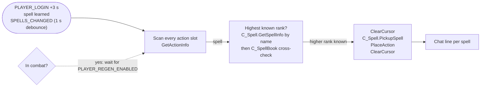

<div align="center">

# Auto Spell Ranks

**Your action bars follow you to the highest spell rank you know.**

[](./AutoSpellRanks/AutoSpellRanks.toc)
[](https://worldofwarcraft.blizzard.com)
[](./AutoSpellRanks/AutoSpellRanks.toc)
[](#license)

[](https://github.com/Moose-Ltd/AutoSpellRanks/actions/workflows/ci.yml)
<!-- Activates once the CurseForge listing is live. -->
[](https://www.curseforge.com/wow/addons/auto-spell-ranks)

Forever has Vanilla-style spell ranks on the Retail client. Train Frostbolt rank 4 and the button on your bar still casts rank 3 until you drag the new one over. This addon does the drag for you, out of combat, every time you learn something.

</div>

---

## Contents

[Highlights](#highlights) · [How it works](#how-it-works) · [Quick start](#quick-start) · [Commands](#commands) · [Development](#development) · [Beta note](#beta-note) · [Repository map](#repository-map) · [Credits](#credits) · [Support](#support) · [License](#license)

For contributors: [`CONTRIBUTING.md`](./CONTRIBUTING.md) · [`CHANGELOG.md`](./CHANGELOG.md)

---

## Highlights

- 🔼 **Always the top rank** - Every spell button on every bar is checked a few seconds after login and again whenever you learn a spell. A button holding an old rank is replaced in place.
- 🎮 **Gamepad UI too** - The game's Gamepad UI (Alpha) keeps its own bars in action slots above the normal 180; those are upgraded the same way.
- 🛡️ **Only ever upgrades** - The client is asked for the highest rank by name, then the spellbook is cross-checked. A swap happens only when the new rank is strictly higher and known to you.
- ⚔️ **Combat-safe** - Nothing moves while you are fighting; the scan waits for combat to end. Macros, items and empty slots are never touched, and a scan waits if you are dragging something.
- 💬 **Says what it did** - One chat line per spell, such as `Demon Armor -> Rank 3 (2 buttons)`. Turn it off with `/asr report off`.
- 🪶 **One file, no settings window** - Two toggles, both on by default, controlled from chat.

Name-based macros such as `/cast Demon Armor` already cast the highest rank on their own. This addon covers plain spell buttons dragged from the spellbook.

## How it works



- **Triggers** - Three seconds after login, and one second after any spell-learned event (`LEARNED_SPELL_IN_SKILL_LINE`, or its older name, plus `SPELLS_CHANGED`). `/asr scan` runs it on demand.
- **Rank lookup** - `C_Spell.GetSpellInfo(name)` returns what `/cast name` would cast. If that answer is missing, the same rank, or lower, the spellbook is scanned for every entry with that name and the highest non-low-rank entry wins. Rank numbers come from `C_Spell.GetSpellSkillLineAbilityRank`, with the "Rank N" subtext as fallback.
- **Swap** - Pick up the new rank, confirm the cursor holds a spell, place it on the slot, clear the cursor. If `PlaceAction` throws, the addon prints one line and disables itself for the session rather than retrying.
- **Guards** - Every value that could be a secret passes through `issecretvalue` before it is compared. Every `C_*` call is checked for existence first.

## Quick start

1. Install:
   - **CurseForge app** - pick the Forever flavour and search for Auto Spell Ranks, or
   - **Manual** - copy the `AutoSpellRanks` folder into `World of Warcraft\_classic_beta_\Interface\AddOns\`, or
   - **Development** - run `.\install.ps1` to link this repo's `AutoSpellRanks` folder into the game (`-Copy` to copy instead, `-Path` for another install).
2. Start the game and tick Auto Spell Ranks on the AddOns screen.
3. Play. Type `/asr` to see the status line.

## Commands

| Command               | What it does                                      |
| --------------------- | ------------------------------------------------- |
| `/asr`                | Show whether upgrades and chat reports are on     |
| `/asr on`, `/asr off` | Enable or disable automatic upgrades              |
| `/asr report on\|off` | Print a chat line for each swap, or stay quiet    |
| `/asr scan`           | Scan the bars now and print a summary             |
| `/asr debug`          | List what each button on screen holds, saved to `AutoSpellRanksDB.debug` on `/reload` |
| `/asr help`           | List the commands                                 |

`/autospellranks` works the same as `/asr`.

## Development

```powershell
.\install.ps1                          # junction AutoSpellRanks/ into the beta AddOns folder; /reload in game after edits
.\package.ps1                          # build dist/AutoSpellRanks-<version>.zip for CurseForge
node tools/check.js                    # parse the Lua as 5.1 (needs luaparse: npm i -g luaparse@0.3.1)
node tools/make_icon.js                # regenerate media/icon.tga and the PNG previews
node tools/make_icon.js --png out.png --size 512   # the icon at any size (avatars, listings)
```

[`ci.yml`](./.github/workflows/ci.yml) runs the parse and a TOC check on every push, and fails a pull request that changes the addon without a changelog line.

### Releasing

Every change adds a line under `## Unreleased` in `CHANGELOG.md`. A release is: rename that heading to the version, bump `## Version` in the TOC, commit `Version X.Y.Z-forever`, tag `vX.Y.Z-forever`, push with tags. [`release.yml`](./.github/workflows/release.yml) builds the zip, publishes the GitHub Release and uploads to CurseForge with the changelog section as the file notes. Patch releases are welcome. Setup and the variables involved are in [CONTRIBUTING.md](./CONTRIBUTING.md).

## Beta note

The Forever beta client writes addon saved variables on logout but does not read them back at launch, so every addon starts from defaults each session. For this addon that means the two toggles return to their defaults, both on, after every login. That is harmless: the defaults are the behaviour you installed it for. When Blizzard fixes loading, `/asr off` and `/asr report off` will stick.

## Repository map

```
AutoSpellRanks/
├── AutoSpellRanks/
│   ├── AutoSpellRanks.toc    # Interface 16001 + 120105, SavedVariables, licence and website
│   ├── AutoSpellRanks.lua    # Everything: lookups, swapping, events, slash commands
│   └── media/icon.tga        # Addon icon (generated by tools/make_icon.js)
├── tools/
│   ├── check.js              # Lua 5.1 parse of every addon file
│   ├── make_icon.js          # Icon generator (TGA + PNG, any size)
│   └── *.png                 # Icon previews and avatar export
├── .github/
│   ├── workflows/ci.yml      # Parse + TOC checks on every push and PR
│   ├── workflows/release.yml # Builds and attaches the zip when a v* tag is pushed
│   └── ISSUE_TEMPLATE/       # Bug report and feature request forms
├── install.ps1               # Link or copy the addon into a WoW install
├── package.ps1               # Build the release zip locally
├── CHANGELOG.md              # Release notes
├── CONTRIBUTING.md           # Setup, conventions, bug reports, shipping
├── LICENSE                   # Proprietary terms
└── README.md                 # You are here
```

## Credits

- Extracted from the Spell Ranks module of [MooseMode](https://github.com/Moose-Ltd/MooseMode), the same author's larger quality-of-life addon.
- API baseline for the Forever beta captured by [forever-addon-kit](https://github.com/Thunderz96/forever-addon-kit).

World of Warcraft and Blizzard Entertainment are trademarks of Blizzard Entertainment, Inc. Auto Spell Ranks is an independent fan project and is not affiliated with or endorsed by Blizzard Entertainment.

## Support

If this saves you a trip to the spellbook every level, the kettle bill thanks you.

[](https://ko-fi.com/mooseza)

## License

Copyright © 2026 Matt Berry / Moose Ltd. All rights reserved. See [LICENSE](./LICENSE).
